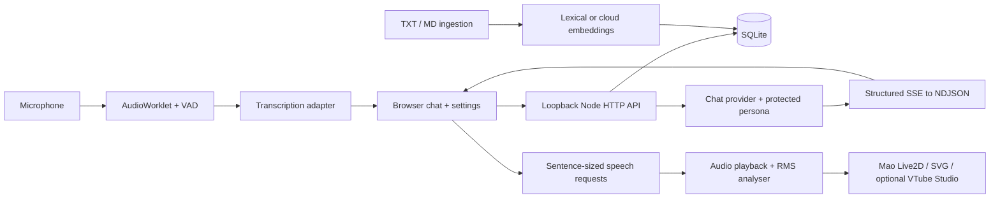

# Architecture

## Implementation choice

The workspace was initially empty with Windows PowerShell, Node 22.18.0 and Python 3.9.13. A dependency-free Node/browser/SQLite implementation was already underway when the expanded AGENTS.md appeared. It remains runnable with zero network installation; npm registry access was subsequently denied. The preferred React/TypeScript/FastAPI/PostgreSQL/LiveKit stack was therefore not adopted. This is an explicit portability tradeoff, not a claim that SQLite or a recorded-utterance pipeline reproduces LiveKit.

All app code and SVG artwork are original. No Open-LLM-VTuber source, model or assets were reused. Its repository was reviewed as a component reference; its separate frontend and Live2D licensing reinforce the decision not to import assets blindly.

## Modules

- `server/index.js`: HTTP routing, host/origin/token checks, limits, active-turn cancellation and transactions.
- `server/providers.js`: injectable chat, transcription and synthesis adapters. `contracts.d.ts` describes boundaries. Test doubles use the same interfaces.
- `server/personality.js` and `characters/hiraya.json`: protected identity separate from history. `delivery.js` separates display text, normalized speech, bounded emotion intensity and avatar expression.
- `server/store.js`: SQLite schema, CRUD, owner-bound queries, summary exclusions, metrics and durable usage reservations.
- `server/memory.js`: conservative grounding/sensitivity checks and visible conflict detection.
- `server/knowledge.js`: safe text chunking, embedding provider, compatible-model filtering and bounded retrieval.
- `server/stream.js`: SSE parsing and incremental JSON string decoding; only text is exposed during generation, final JSON is validated before persistence.
- `public/app.js`: accessible forms/dialogs, lifecycle ownership, history, drafts, memory, documents and auditions.
- `public/audio.js`, `audio-core.js`, `mic-worklet.js`: microphone lifetime, PCM/WAV conversion, VAD, speech cancellation and actual amplitude measurements.
- `public/avatar.js`, `vtube.js`: bounded visual expression, same-origin overlay events, explicit optional local VTube Studio authentication.

## Turn and audio lifecycle

States are idle, requesting microphone, listening, transcribing, thinking/writing, preparing voice, speaking, reconnecting and error. The voice input object owns recognition or the cloud microphone stream; Record is mutually exclusive with hands-free. Tracks stop on end, session switch and page exit. A permission promise resolving after cancellation immediately releases its tracks.

Cloud capture buffers 350 ms of pre-roll, requires 120 ms of above-threshold input, and ends after configurable silence (850 ms default). Noise floor adapts while idle. Utterances are capped at 20 seconds. Browser echo cancellation/noise suppression are requested, not guaranteed. This energy detector does not perform semantic turn detection or speaker separation.

Each fresh turn increments a browser epoch. Interruption pauses audio, cancels synthesis and chat HTTP requests, removes provisional text, and invalidates stale results. The server cancels an older turn in the same session and only commits a complete user/assistant pair. Interrupted partial generation is not persisted. A browser disconnect aborts server work. Provider cancellation cannot guarantee reversal of provider billing.

The model's real text deltas are relayed, never simulated typing. Once the final structured result is validated, speech is normalized and divided into coherent sentence/word-boundary segments. Each segment is synthesized and played in order; MP3 is buffered per segment, not streamed byte-by-byte. This reduces individual TTS buffer size but **does not overlap TTS with model generation**. A WebRTC/LiveKit transport is a future latency improvement.

Completed segment lengths are acknowledged. Interrupted speech is marked as only partly heard, and that qualification is included in later history. This is a conservative sentence-boundary estimate; it is not phoneme/word alignment and normalized speech length may differ from displayed text. Text displayed and audio heard are different records.

## Memory and knowledge

Recent history is bounded to 24 messages. Older same-session user excerpts form an extractive summary (up to eight 160-character excerpts), explicitly attributed and untrusted. Summary generation cannot rewrite the character prompt.

Memories are facts, preferences or experiences. Metadata includes owner, source, created/updated timestamps, confirmation, confidence, optional superseded reference and optional expiry. Current user-confirmed notes have confidence 1 and no expiry. Model proposals must be literal excerpts of the current message, pass sensitive/quoted/hypothetical filters, and require a user Save action. Manual notes are explicit user assertions. Contradiction detection is conservative and lexical; conflicting prefix patterns surface an error directing the user to edit rather than silently overwriting.

Retrieval scopes by owner first, ranks by term overlap/recency, then takes 12 notes (maximum 500 characters each). Memory corrections/deletion clear summaries and exclude matching source messages from future summaries. Old chat text remains until its conversation is removed. There is no automatic weight training.

Knowledge is a separate document/chunk store with model-tagged vectors. Documents are plain text only, never executed. Retrieval supplies at most four 700-character chunks. Inline references are model-generated; the UI additionally labels the exact references supplied, rather than claiming the model used every passage. Deletion cascades to chunks/vectors.

## Security and operations

The server binds only `127.0.0.1`; Host validation blocks DNS rebinding, Origin/Sec-Fetch-Site checks block cross-site access, and API mutations require a random process token. Static files use an explicit allowlist. CSP limits scripts/resources to the app, plus the opt-in VTube Studio WebSocket on port 8001. No model shell, arbitrary file access, purchases, web search or external actions exist.

The process token is not multi-user authentication. Database owner IDs prepare some boundaries; singleton settings and usage still assume a single local owner. Multi-user deployment requires a separate authentication/authorization design. Source memory IDs are validated. Schema uses SQL parameters, foreign keys, WAL and explicit transactions. Startup checks add owner columns to the initial schema; `PRAGMA user_version=2` identifies this release. Backups should be taken while stopped.

Provider keys stay in server environment variables. Audio is held in memory only. Logs do not include prompts, transcripts, raw provider errors or keys. Limits include 4,000-character messages, 3 MB WAV bodies, 200 sessions, 200 notes, 20 documents, 100 mutations/minute and persistent UTC-day provider/speech reservations. No external telemetry is sent.

Metrics include completed chat and first-text timing, transcription duration, buffered TTS readiness, provider token usage, and client playback-start/stop-call timing. Client timings measure API calls to playback, not acoustic sound at the ear. Cost estimate is deliberately unavailable without configured prices; provider invoices are authoritative.

## Avatar transport

The default browser renderer loads the user-supplied `mao_en/runtime/mao_pro.model3.json`. `AvatarAssets` validates all manifest references and exposes only that fixed asset set, the original model notice, and four named runtime scripts. Editor `.cmo3`/`.can3` files and arbitrary paths are never served. `/api/avatar` reports readiness without revealing local paths. `AVATAR_PROVIDER=svg` selects the earlier renderer.

`MaoAvatar` uses an optional local Pixi 7/display adapter and user-supplied Cubism Core. The official Pixi CSP patch removes its JavaScript evaluation requirement; only WebAssembly compilation is enabled in CSP. There are no CDN script loads. A per-frame hook sets Mao's `ParamA` after idle motions and expressions, using actual audio amplitude and forcing zero after stop. Expressions are deduplicated per emotion. The app ticker owns model updates, allowing visibility changes to pause rendering; teardown releases observers and GPU resources. Installation and unverified real-rendering status are documented in `MODEL_SETUP.md`.

Cloud audio uses actual Web Audio RMS for mouth openness; device synthesis does not fake an amplitude signal. Emotions update per turn. Browser events and `BroadcastChannel('hiraya-avatar-v1')` carry `{version:1, state, emotion, mouth, speaking}`. The transparent overlay requires the same origin/browser storage partition; a separate OBS browser engine may not share BroadcastChannel. Use a browser/window capture or a future bridge for that case.

The optional VTube adapter connects directly from this local browser to `ws://127.0.0.1:8001`, requests a plugin token, authenticates, injects a configured mouth input at up to 10 Hz, and invokes explicitly configured expression hotkeys only on changes. The token exists in memory only. Disconnects stop injection and require an explicit reconnect. This never launches VTube Studio or starts a stream. A remote deployment would need a local bridge and its own authorization.
